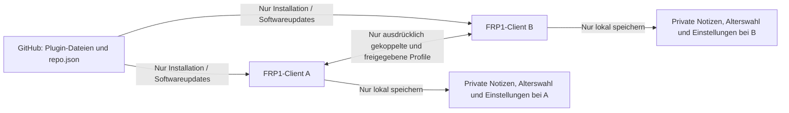

# Final Roleplay 1 (FRP1)

**Rollenspielprofile für Final Fantasy XIV, die auf deinem Rechner bleiben und nach deiner Freigabe direkt mit anderen FRP1-Clients ausgetauscht werden. Ohne FRP1-Profilserver, zentrale Profildatenbank oder Registrierung.**

FRP1 ist ein Dalamud-Plugin für Charakterbeschreibungen, erste Eindrücke, RP-Status und Kontakte. Es orientiert sich beim Bedienkonzept an Total RP 3 und übernimmt die lokal beziehungsweise direkt zwischen Clients umsetzbaren Funktionen von Glance in einer eigenen FFXIV-Oberfläche.

**Stand: 2026-11-10 – früher öffentlicher Teststand 0.1.0.0 in Veröffentlichungsvorbereitung.** Der Code besteht 467 Tests, Release-Build und unabhängiges Review. Eine tatsächliche Spielabnahme und reale LAN-/Internet-/NAT-Abnahme sind noch nicht erfolgt.

## Kein zentraler Server für deine Profile

FRP1 lädt deine Charakterprofile nicht auf eine Website, in eine Cloud oder in eine zentrale Datenbank hoch. Ein öffentliches Profil bleibt zunächst eine lokale Datei. Nur wenn du einen anderen FRP1-Client ausdrücklich koppelst, eine erreichbare direkte Verbindung herstellst und dein Profil für diesen Kontakt freigibst, wird es direkt dorthin übertragen.

**„Öffentliches Profil“ bedeutet hier ein zum Teilen vorgesehenes Profildokument, keine Veröffentlichung im Internet.** Es wird nicht automatisch auffindbar oder für alle Spieler sichtbar.

Private Profil- und Charakternotizen, Beziehungen, Favoriten, Besuchsverlauf, eigene Charakterzuordnungen, Altersauswahl und persönliche Einstellungen bleiben ausschließlich lokal. Sie sind kein Bestandteil des geteilten Profils und werden nicht an andere Clients geschickt. Für den Inhaltsfilter wird nur das notwendige Empfangsflag übermittelt, ob ein Client Inhalte ab 18 akzeptiert; kein Geburtsdatum und keine vollständige Altersangabe.

Es gibt keine FRP1-Accounts, Telemetrie, Relay-, STUN- oder Discoverydienste. Ein aktiver Client nimmt direkte Verbindungen anderer ausdrücklich gekoppelter Clients entgegen. Du musst dafür keinen separaten Serverdienst oder Profildatenspeicher betreiben.

**GitHub hat eine andere Aufgabe:** Dort werden ausschließlich Plugin-Dateien, Quelltext und der Installerindex für Installation und Updates bereitgestellt. FRP1-Profile werden nicht zu GitHub übertragen. Die Softwaredownloads und FFXIV selbst verwenden selbstverständlich ihre jeweiligen Dienste; „serverfrei“ bezieht sich auf den Austausch und die Speicherung deiner FRP1-Profildaten.



Das Diagramm zeigt die FRP1-Datenwege. FFXIV-Spielverkehr ist kein FRP1-Profiltransport.

## Installation über die .json-Adresse

**Die folgende Veröffentlichung wird gerade vorbereitet; Verfügbarkeit des Repositorys und Releasepakets ist noch nicht bestätigt.** Die Anleitung gilt nach erfolgreicher Veröffentlichung.

Für Installation und Benutzung ist **kein GitHub-Konto** erforderlich. Nach Veröffentlichung können die öffentliche JSON-Datei und das ZIP-Paket ohne Anmeldung heruntergeladen werden; FRP1 verlangt ebenfalls kein Konto.

Installeradresse für **Custom Plugin Repositories**:

```text
https://raw.githubusercontent.com/demkadse/FinalRoleplay1/main/repo.json
```

1. Nutze XIVLauncher/Dalamud auf Windows mit kompatibler Dalamud API 15. FRP1 ist kein eigenständiges Programm und kein Konsolenplugin.
2. Öffne die Dalamud-Einstellungen mit `/xlsettings`.
3. Gehe zu **Experimental / Experimentell** und **Custom Plugin Repositories / Benutzerdefinierte Plugin-Repositories**.
4. Füge die vollständige obenstehende **.json-Adresse** hinzu, aktiviere den Eintrag und speichere.
5. Öffne `/xlplugins`, aktualisiere bei Bedarf die Liste und suche **Final Roleplay 1**.
6. Installiere das Plugin und öffne es mit `/frp`.

Die GitHub-Projektseite oder eine ZIP-Adresse gehört nicht in das Repositoryfeld. Der Index ist eine JSON-Liste, aus der Dalamud die eigentlichen Installations-/Updatepakete lädt. Grundlage ist das [offizielle Dalamud-Verfahren für eigene Repositories](https://dalamud.dev/plugin-publishing/custom-repositories/).

Geplante Projekt-/Releaseziele: [demkadse/FinalRoleplay1](https://github.com/demkadse/FinalRoleplay1), Tag `v0.1.0.0`, Paket `FRP1-0.1.0.0.zip`. Keine Bestätigung einer erfolgreichen Veröffentlichung, solange der Vorbereitungsstatus oben besteht.

## Die ersten Minuten

1. Lies und bestätige die Profilregeln. Sie bleiben später unter **Einstellungen → Profilregeln und Hinweise** erreichbar.
2. Gib für diese Pluginsitzung aktiv an, ob du mindestens 18 Jahre alt bist. Erwachsene müssen Inhalte ab 18 zusätzlich freigeben, wenn sie diese sehen möchten.
3. Erstelle unter **Mein Profil** ein Profil und speichere es lokal.
4. Öffne `/frpbar` und wähle dein gespeichertes Profil ausdrücklich als aktives RP-Profil für den angemeldeten Charakter. Das erste vorhandene Profil wird nicht automatisch aktiviert.
5. Lies das gespeicherte Profil im Journal und richte bei Bedarf Darstellung und Hilfen ein.
6. Nutze es vollständig lokal oder kopple einen Kontakt für den direkten Austausch.

**Speichern, aktivieren und teilen sind verschiedene Entscheidungen.** Speichern legt die lokale Profilversion ab. Aktivieren ordnet sie deinem lokalen Spielcharakter zu. Zum Teilen bestimmst du dieses aktive Profil zusätzlich ausdrücklich im Netzwerkbereich und erteilst dem gewünschten Peer eine eigene Freigabe.

Die ausführliche Schritt-für-Schritt-Anleitung einschließlich Fehlersuche steht im [deutschen Benutzerhandbuch](docs/benutzerhandbuch.md).

## Was du gestalten und verwalten kannst

| Bereich | Funktionen |
|---|---|
| Charakter | RP-Name/Titel, Volk/Clan, Kurzbeschreibung, Pronomen, Herkunft, Beruf, Aussehen, Persönlichkeit, Hintergrund, freie Felder und OOC-Informationen. |
| RP-Informationen | IC/OOC/AFK, offen/beschäftigt/kein RP, fünf Glances, zehn Anknüpfungspunkte, Traits, Gesprächspräferenzen und beschriebene RP-Sprachen. |
| Journal und Medien | Drei Leselayouts, begrenztes Rich Text, Standarddarstellung, grafischer Spielicon-Picker und lokaler Portraitzuschnitt. |
| Begleiter | Begrenzte Beschreibungen eigener Begleiter; keine Veränderung tatsächlicher Pets oder Mounts. |
| Eigene RP-Leiste | Profilwechsel, Status, Verfügbarkeit, Journalzugriff und anklickbare eigene Glances; beweglich, sperrbar und lokal skalierbar. |
| Gestaltung | Acht Volkspaletten und drei freie Themes; automatische lokale Zuordnung oder freie manuelle Wahl. |
| Privates Register | Profil-/Charakternotizen, Favoriten, Beziehungen, Stummschaltung, Netzblock, Suche und Verlauf geöffneter Profile. |
| Spielanzeigen | Mouseover, bewegliche/pinnbare Zielkarte, nativer Kontextmenüeintrag, optionale lokale Nameplates/Titel/Farben/Profilicons und General-Chatnamen. |
| Umgebung/Karte | Aktuell sichtbare bekannte Akteure, Filter, Anvisieren und Karte für einen bekannten lokalen Akteur. Keine weltweite Suche. |
| Werkzeuge | Höchstens 16 deklarative Automationsregeln, standardmäßig aus; lokale Rede-/Emote-Entwürfe und interne Verweise auf vorhandene erlaubte Profile. |
| Hilfe/Sprache | Globale kontextuelle Hilfen und jederzeit erreichbare Erste Schritte. Neue Module sind DE/EN; ältere Host-/Hilfetexte teilweise deutsch. |

Portraits werden lokal zu metadatenfreien PNG-Miniaturen bis 256 × 256 und 12 KiB normalisiert. Das gesamte öffentliche Profil bleibt höchstens 48 KiB groß. Es gibt keine externen Bildabrufe, eingebetteten Skripte oder automatisches Abspielen fremder Medien.

Die RP-Präferenzen beschreiben Gesprächs- und Spielwünsche. Sie sind keine Zustimmung zu Handlungen und kein Altersnachweis.

## Wie zwei Spieler Profile austauschen

1. **Beide** starten unter **Einstellungen → Direktverbindungen** ihren Clientlistener nach Bestätigung der direkten IP-Sichtbarkeit. Eine Einladung kann erst für einen gestarteten Listener erstellt werden.
2. Beide kopieren ihre eigene Einladung und tauschen diese über einen vertrauenswürdigen Weg aus.
3. Beide fügen die Einladung des anderen ein und wählen **Einladung koppeln – ohne Profilfreigabe**.
4. Eine Person startet die Verbindung zum gekoppelten Kontakt. Die Clients authentifizieren einander anhand der bestätigten Fingerprints.
5. Jede Person wählt das eigene aktive Profil über **Dieses aktive Profil zum Teilen verwenden** ausdrücklich zum Austausch.
6. Jede Person setzt für den gewünschten Kontakt **Profil für diesen Kontakt freigeben**.

Erst die Kombination aus erlaubtem Netzbetrieb, beidseitiger Kopplung, gültiger Verbindung, ausdrücklich gewähltem Teilprofil und jeweiliger Peerfreigabe erlaubt den Austausch. Änderungen eines bereits aktiven und freigegebenen Profils werden nach dem Speichern automatisch anhand Revision und Hash synchronisiert.

Die dauerhafte Identität wird unter Windows mit DPAPI im lokalen Benutzerkontext geschützt. Gespeicherte Kopplung beweist den Besitz eines Schlüssels, nicht den Besitz eines FFXIV-Charakters. Für Anzeigen fremder Profile muss Name/Homeworld zusätzlich ausdrücklich lokal der richtigen Peer-/Profilidentität zugeordnet werden.

## Grenzen direkter Verbindungen

Die Gegenstelle sieht bei einer direkten Verbindung deine IP-Adresse. Ohne vermittelnde Dienste lässt sich nicht garantieren, dass zwei beliebige Heim-/Mobilfunknetze erreichbar sind: Firewalls, NAT und CGNAT können Verbindungen verhindern.

Ein fester lokaler Listenport und eine manuell angegebene numerische Einladungsadresse sind optionale Hilfsmittel. Sie ermitteln keine öffentliche IP, öffnen keine Ports und ändern weder Router, Firewall noch DNS. Eine Einladung umgeht diese Netzgrenzen nicht.

Das Plugin benötigt keine manuelle Einrichtung eines FRP1-Servers; es kann trotzdem sein, dass eine Direktverbindung in einem bestimmten Netz nicht möglich ist. Das ist keine fehlende Registrierung oder erforderliche Cloudfreischaltung.

## Profilregeln, Alter und Widerruf

Allgemein/jugendfrei gekennzeichnete Profile dürfen keine sexuellen oder sonstigen expliziten Inhalte ab 18 enthalten – auch nicht in Namen, Titeln, Glances, Freitexten oder Bildern. Die Kennzeichnung gilt für das gesamte Profil. Gib das Alter deiner realen Person wahrheitsgemäß an.

Sexualisierte Minderjährigendarstellungen, unerlaubte private Daten anderer, Belästigung und Inhalte ohne nötige Nutzungsrechte sind untersagt. Die Regeln sind lokal lesbar und versionsgebunden zu bestätigen; es gibt keine zentrale Profilprüfung oder Moderationsinstanz.

Nach jedem Pluginstart verlangt FRP1 erneut die aktive Alterswahl. Erwachsene müssen Mature-Inhalte zusätzlich erlauben. Gespeicherte Regelbestätigung, Theme oder Profilpräferenz erteilen keine Altersfreigabe. **Die Angabe bleibt Selbstauskunft, keine Altersverifikation.** Falsche Angaben oder bewusst falsche Inhaltskennzeichnungen können nicht zuverlässig erkannt werden.

Bei Widerruf werden Verbindungen geschlossen und gesperrte Ansichten entfernt. Bereits empfangene Dateien auf einem anderen Rechner können dadurch nicht zurückgeholt werden. Auch der eigene bestehende Cache wird nicht allein durch einen Alterswechsel gelöscht oder verschlüsselt.

Chatnamensersetzung verwendet ausschließlich allgemein gekennzeichnete Profile, weil bereits ausgegebener Chat nicht zuverlässig zurückgenommen werden kann. Mature-Namen bleiben auch bei Erwachsenenfreigabe aus diesem bleibenden Chat ausgeschlossen.

## Updates, Prüfung und Entwicklungsstand

Softwareupdates laufen über den normalen Dalamud-Installer und die Repositoryadresse; FRP1 betreibt keinen eigenen automatischen Updater und keinen Profilserver. Profiländerungen zwischen bereits verbundenen freigegebenen Peers sind davon unabhängig.

Der geprüfte Codestand besteht **467/467 Tests**, ohne Fehler oder übersprungene Tests, einen vollständigen Release-Build mit **0 Warnungen/0 Fehlern** und das abschließende unabhängige Review ohne kritische oder wichtige Restbefunde. Die separate Probe besteht acht Gruppen mit zwei echten Loopback-TLS-Clients.

**Nicht tatsächlich abgenommen:** Bedienung/Renderdarstellung im laufenden Spiel, reales LAN/Internet, NAT/CGNAT und umfangreiche Belastung. Dies ist ein früher Teststand, keine Zusicherung reibungsloser Verbindung zwischen beliebigen zwei Spielern.

Taschen/Inventar und TRP3 Extended sind ausgeschlossen. WoW-/MSP-Import, Musik und lokale UI-Klick-/Bestätigungstöne sind nicht implementiert. RP-Sprachen sind Profilangaben, kein Eingriff in Spielsprache. NPC-Werkzeuge sind ausschließlich lokale Textentwürfe, keine NPC-Imitation oder Chatautomation.

## Für Entwickler

Windows, .NET-10-SDK, lokale Dalamud-API-15-Entwicklungsbibliotheken und `Dalamud.NET.Sdk/15.0.0` sind die Buildgrundlage. Normale Installation über Dalamud benötigt keinen eigenen Quellcodebuild.

```powershell
dotnet build FRP1.slnx -c Release --nologo
dotnet test FRP1.slnx -c Release --nologo -p:BuildInParallel=false
dotnet run --project tools/FRP1.Probe -c Release -- --self-test
```

Release-Ausgaben aus dem Entwicklungsbuild: `src/FRP1.Plugin/bin/Release/FRP1.Plugin.dll` und `src/FRP1.Plugin/bin/Release/FRP1.Plugin/latest.zip`. Die Veröffentlichungsvorbereitung verwendet das geplante Paket `FRP1-0.1.0.0.zip`.

Weitere Dokumentation: [Benutzerhandbuch](docs/benutzerhandbuch.md), [Release-Notes 0.1.0.0](docs/release-notes-v0.1.0.0.md), [Status](STATUS.md), [Übergabe](HANDOFF.md), [Architektur](docs/architecture.md), [Machbarkeit](docs/feasibility.md), [TRP3-Abgleich](docs/trp3-feature-map.md), [Glance-Abgleich](docs/glance-feature-map.md), [UX/Gestaltung](docs/ux-and-vanity.md).

FRP1 ist eigenständig implementiert; keine Übernahme von TRP3-/Glance-Code oder WoW-Assets. Eine gesonderte Open-Source-Lizenz für den eigenen Code ist noch nicht festgelegt; öffentliche Einsehbarkeit ändert diesen Status nicht. Fremdkomponenten behalten ihre jeweiligen Lizenzbedingungen; siehe [mitgelieferte Hinweise](THIRD-PARTY-NOTICES.txt).

