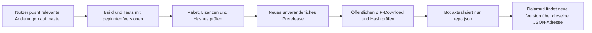

# Automatische Installer-Releases nach einem Nutzerpush

Stand: 2026-11-12 · **Automatik erfolgreich auf GitHub geprüft; 0.1.1.2 veröffentlicht.** [Lauf 43243803893](https://github.com/demkadse/Final-Roleplay-1/actions/runs/43243803893) zu Quellcommit `66cc768` besteht Build und Publish. Die Protokolle belegen 0 Warnungen/Fehler, 500/500 Funktionstests, 33/33 Paketprüfungen und alle 105/105 CI-Prüfungen.

Fünf Profilbereiche, kompaktes einklappbares HUD und feldnahe Hilfen sind jetzt im öffentlichen Installerpaket enthalten. [Release v0.1.1.2](https://github.com/demkadse/Final-Roleplay-1/releases/tag/v0.1.1.2) ist öffentlich, als Prerelease markiert und kein Entwurf. Botcommit `14f92bb` aktualisiert ausschließlich den Installerindex. JSON, ZIP und Prüfsummen sind anonym geladen, gemeinsam per SHA-256 geprüft und erneut paketvalidiert. Eine lokale Benutzerinstallation 0.1.0.0 wird durch den Nutzer über Dalamud aktualisiert; keine Installation erfolgte durch den Agenten.

## Was nach Einführung automatisch passiert

Nach Einführung auf `master` löst ein relevanter Push folgende Kette aus:



Relevante Änderungen betreffen Quellcode, Build, Tests, Releaseworkflow oder Lizenzunterlagen. Reine Dokumentations- oder Indexänderungen sollen keine weitere Releasekette auslösen. Zusätzlich ist ein bewusster manueller Workflowstart auf `master` vorgesehen; andere Branches veröffentlichen nicht.

Die Installeradresse bleibt:

```text
https://raw.githubusercontent.com/demkadse/Final-Roleplay-1/master/repo.json
```

`repo.json` wird erzeugt, nicht von Hand auf eine neue Versionsnummer editiert. Das bereits veröffentlichte v0.1.0.0 wird nicht überschrieben.

## Kurzanleitung für den Maintainer

1. Änderungen einschließlich Workflow, CI-Hilfen, Build-/Paketänderungen und Tests prüfen und committen. Die Automatik ist seit `ffe036c` eingeführt.
2. Den eigenen `master`-Stand abgleichen und pushen. Ein relevanter Push löst die Automatik aus.
3. Im [Actions-Bereich des Repositorys](https://github.com/demkadse/Final-Roleplay-1/actions) den passenden Lauf zum eigenen Sourcecommit öffnen.
4. Build-/Testjob und anschließenden Publishjob prüfen. Ein erfolgreicher Sourcepush allein ist kein erfolgreicher Installerrelease.
5. Nach erfolgreichem Publish Release, ZIP und aktualisierten Index prüfen. Das Release bleibt als früher Teststand/Prerelease gekennzeichnet.
6. Im Dalamud-Installer die üblichen Softwareupdates verwenden; die Custom-Repository-Adresse muss nicht geändert werden.

Reine Dokuänderungen veröffentlichen kein neues Paket. Soll ein Lauf bewusst manuell gestartet werden, den Releaseworkflow in Actions öffnen, `master` wählen und den manuellen Start verwenden. Dies setzt voraus, dass die Workflowdatei bereits auf GitHub vorhanden ist.

## Versionsnummern

Die Versionsbasis ist `0.1.1`. Als vierte Komponente dient `GITHUB_RUN_NUMBER - 1`:

| Workflowlauf | Pluginversion |
|---|---|
| Lauf 1 | 0.1.1.0 |
| Lauf 2 | 0.1.1.1 |
| Lauf 3 | 0.1.1.2 |

Eine Wiederholung desselben Laufs verwendet dessen gleiche Versionsnummer; sie ist kein neuer Versionslauf. Ein fehlgeschlagener Lauf muss deshalb nicht bereits eine öffentlich verfügbare Version erzeugt haben.

Die Buildproperty `Frp1Version` überschreibt ausschließlich die Pluginversion. FRP1.Core behält seine eigene Assemblyversion 1.0.0.0; nicht pauschal alle DLL-Versionen gleichsetzen.

## Schutzgrenzen

- Build auf Windows mit .NET-SDK 10.0.401 und ausdrücklich gepinntem offiziellem Dalamud 15.0.4/API 15 über `DALAMUD_HOME`. Kein stilles „latest“/API-17-Upgrade.
- Buildjob nur mit Leserechten und ohne persistierte Checkout-Credentials; Publishjob erst nach Erfolg mit den erforderlichen Schreibrechten.
- Ausschließlich integriertes, kurzlebiges `GITHUB_TOKEN`; kein zusätzlicher PAT, Account, Profilserver oder Registrierungsschritt.
- Paketprüfung umfasst Manifest/Pluginversion, MIT-/Fremdkomponentenunterlagen, PDB und PE-/Dateihashes.
- Bestehende Releaseassets nicht überschreiben. Identischer Inhalt darf wiederverwendet beziehungsweise als No-op behandelt werden; abweichender Hash stoppt.
- Source-Head-/CAS-Prüfungen verhindern, dass ein veralteter Lauf den aktuellen Branch/Index überschreibt.
- Indexaktualisierung erst nach erfolgreicher öffentlicher ZIP-/Hashprüfung. Ein Fehler lässt den bisherigen Installerindex verwendbar.
- Der Botcommit darf ausschließlich `repo.json` ändern. Keine zusätzlichen Source-, Dokumentations- oder Profildateien werden dadurch gepusht.

Nach einem Botcommit ist der GitHub-Branch einen Commit weiter. Vor dem nächsten lokalen Push abgleichen, etwa mit `git pull --ff-only`. Wenn das nicht vorwärts möglich ist, die Abweichung prüfen und sauber auflösen; kein Force-Push als Abkürzung.

## Fehlersuche

| Beobachtung | Bedeutung / nächster Schritt |
|---|---|
| Nach Sourcepush kein neuer Lauf | Workflow schon auf `master` eingeführt? Nur Dokumentation/Index geändert oder nicht der Masterbranch? Richtigen Commit im Actions-Bereich prüfen. |
| Build oder Test rot | Im betroffenen Job den ersten echten Fehler prüfen. Ohne erfolgreichen Build/Test kein Publish erwarten. |
| Alter Sourcejob stoppt | Neuere Branchänderung kann den Head-/CAS-Schutz ausgelöst haben. Den aktuellen Stand prüfen, keinen alten Index erzwingen. |
| Wiederholung meldet abweichenden Assethash | Vorhandenes Release nicht ersetzen. Ursache/Artefakte prüfen; kein „Clobber“ verwenden. |
| Release vorhanden, Index nicht aktualisiert | Öffentliche Verfügbarkeit/Hash und Branchprüfung können fehlgeschlagen sein. Bisheriger Index bleibt gültig; Publishprotokoll prüfen. |
| Dalamud zeigt noch alte Version | Erst erfolgreiche neue Veröffentlichung samt Index prüfen, dann Installer aktualisieren. Sourcepush oder lokale Builds allein reichen nicht. |

## Was diese Einrichtung nicht verändert

GitHub baut und verteilt Software sowie Installerindex; es wird kein FRP1-Profilbackend. Spielerprofile gehen weiterhin ausschließlich direkt an ausdrücklich gekoppelte/freigegebene Clients. Private Notizen, Altersauswahl, Content-IDs, Zuordnungen und Einstellungen bleiben lokal. Normale Pluginnutzer benötigen kein GitHub-Konto.

Die lokale Einrichtung besteht den Release-Build gegen das frisch verifizierte API-15.0.4-`DALAMUD_HOME` ohne Warnungen/Fehler, 500/500 Funktionstests, 33/33 Paketprüfungen und 101/101 zusätzliche CI-Prüfungen: 33 Versions-/Releasepolicyfälle, 24 simulierte Veröffentlichungsabläufe und 44 SDK-/Pfad-/Metadatenfälle. Kandidat 0.1.1.0 ist paketvalidiert; ZIP, Index und Prüfsummen sind bei zwei lokalen Erstellungen byteidentisch. actionlint 1.7.12 meldet keine Workflowfehler. Das abschließende unabhängige Review ist ohne kritische oder wichtige Restbefunde freigegeben.

Historie: Der erste GitHub-Lauf stoppte an einer PDB-Pfadabweichung. Der SourceRoot-Fix ermöglichte Release 0.1.1.1, doch ein vorzeitiges erfolgreiches Skriptende ließ die 101 Helferprüfungen aus. Der anschließende Exitcode-Fix ist durch frische Shellproben für Erfolg und Fehler sowie unabhängiges Review abgesichert. Der neue Lauf belegt ausdrücklich Paket33, Policy33, Publish24, SDK44 und Compiler4. Erst diese Protokolle begründen den vollständigen Hosted-Nachweis. Einzelheiten: [STATUS.md](../STATUS.md).

Spiel-/LAN-/Internet-/NAT-/CGNAT-Abnahme bleibt weiterhin offen. [Benutzerhandbuch](benutzerhandbuch.md), [Architektur](architecture.md), [Übergabe](../HANDOFF.md).

